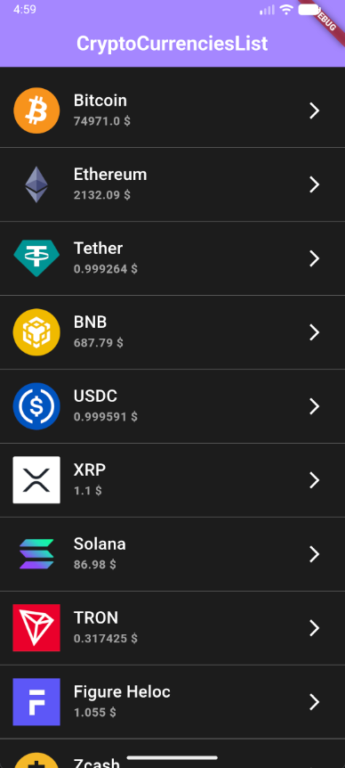
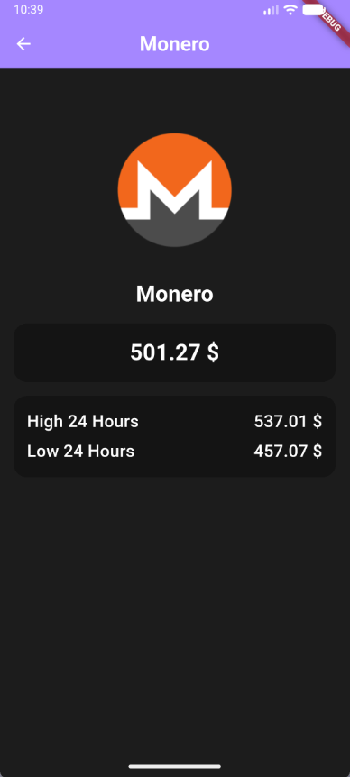

# crypto_coins_list

Учебный проект крипто-трекера на Flutter на базе [курса Стаса Ильина (FrezyCode)](https://github.com/Frezyx/flutter_tutorials/tree/main/crypto_coins_list).

### Что реализовано и изменено относительно базового курса:
- **Миграция на CoinGecko API:** вместо устаревшего API из курса самостоятельно подключен и настроен парсинг данных с CoinGecko (работа со списком объектов вместо `RAW`-словарей).
- **Адаптация под актуальный Flutter 3 / Dart 3:** обновлена тема приложения и зависимости.

### Скриншоты:

  
  

